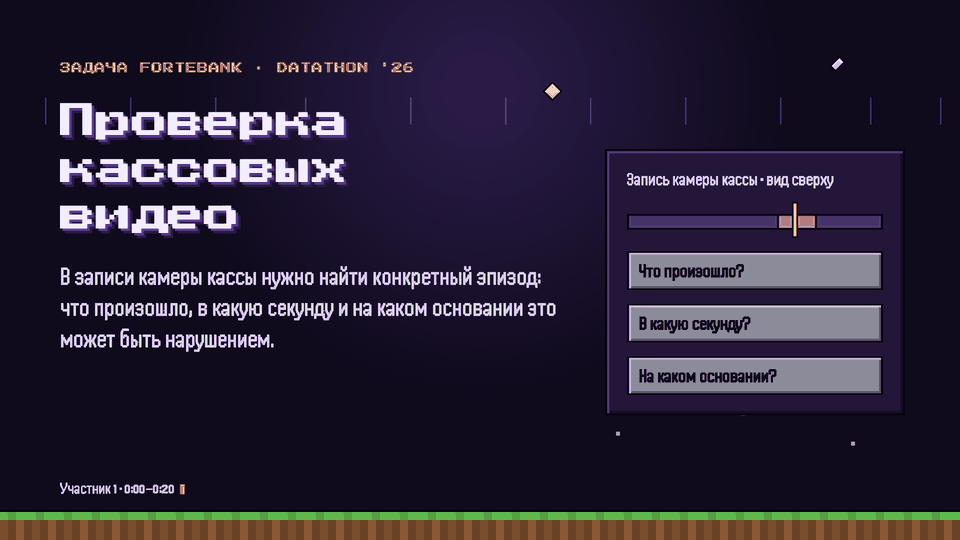
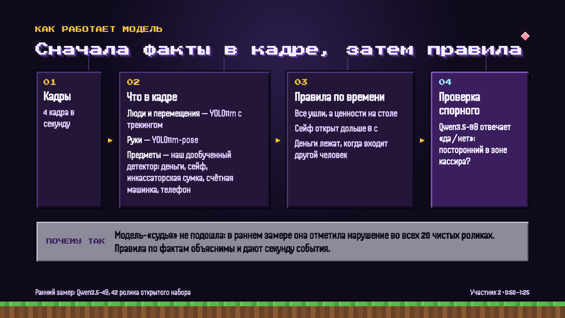
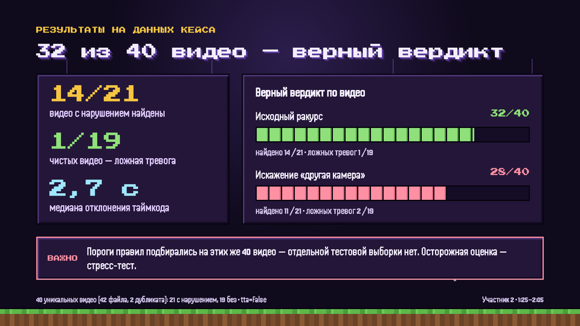
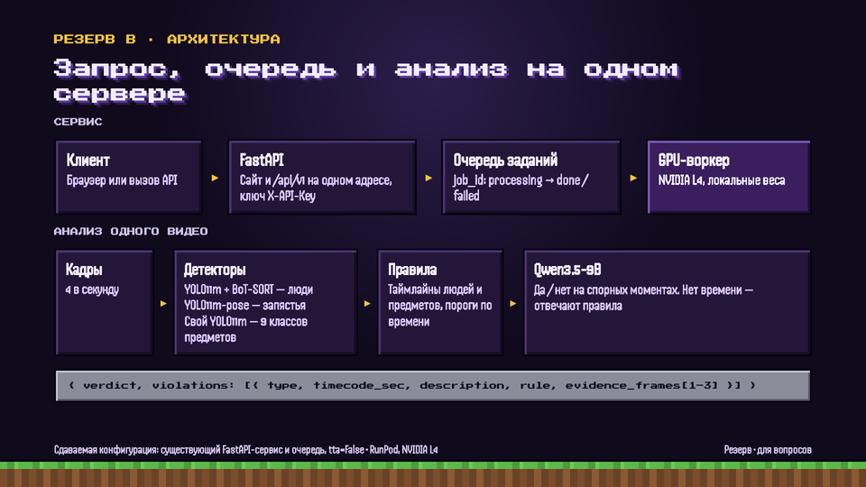
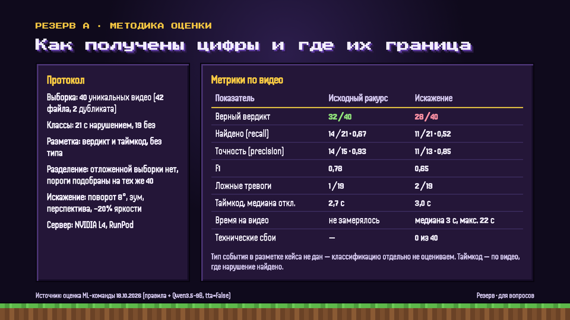
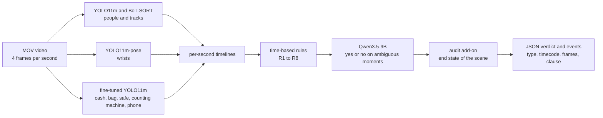
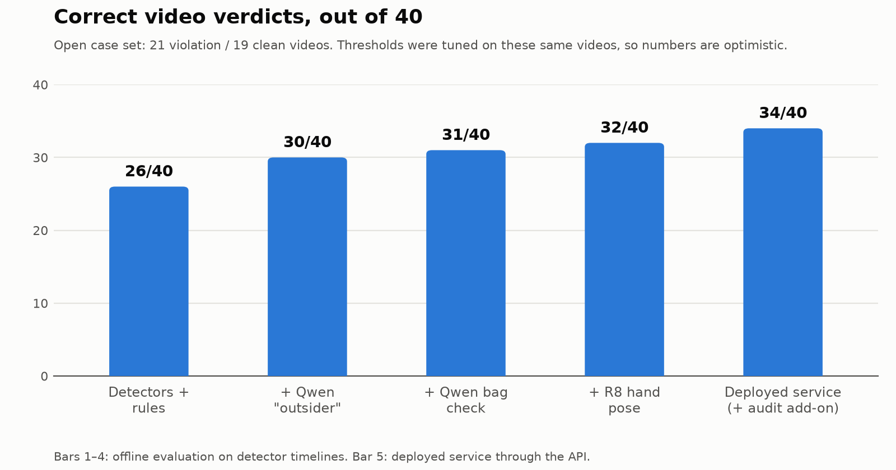

<div align="center">
  
  <h1>CashGuard</h1>
  <p><strong>Local AI that reviews bank cash-desk CCTV, flags possible cash-handling violations and explains each one —<br/>
  type, second, evidence frames and the regulation clause.</strong></p>
  <p>
    <a href="#how-it-works">How it works</a> ·
    <a href="#results">Results</a> ·
    <a href="#running-it">Run it</a> ·
    <a href="#documentation">Docs</a> ·
    <a href="https://github.com/salauatabdraimov65-wq/cashguard-forte-datathon26">Team repo</a> ·
    <a href="#на-русском">На русском</a>
  </p>
  <p>
    
    
    
    
    
    
  </p>
</div>



<div align="center">

**34/40** correct verdicts · **2/19** false alarms · detector **mAP50 0.863** · median **17 s** per video · **0** cloud AI calls

</div>

## Watch less. Check the right second.

| Detect | Explain | Deploy |
| :--- | :--- | :--- |
| People, hands, cash, bags and the safe on every frame | Event type, timecode and 1–3 evidence frames | Web UI + jury API on one address |
| Time-based rules catch "everyone left, cash on the desk" | Regulation clause from a fixed catalogue — never generated | Fully local on one GPU, no cloud AI APIs |

Built in 24 hours at DATATHON '26 (NU Data Science Club × ForteBank, Astana, 17–18 Oct 2026).
The output is a hint for a human reviewer, not a verdict of guilt.

<details>
<summary><strong>Explore the pitch deck</strong> · model, results, architecture, evaluation</summary>

<table>
  <tr>
    <td></td>
    <td></td>
  </tr>
  <tr><td align="center">How the model works</td><td align="center">Results of the ML pipeline</td></tr>
  <tr>
    <td></td>
    <td></td>
  </tr>
  <tr><td align="center">Architecture</td><td align="center">Evaluation method</td></tr>
</table>

Slides are in Russian — the pitch was given in Russian.

</details>

## The problem

A camera above the cash desk records the teller. A reviewer does not need "something suspicious" — they need a specific
episode: **what happened, at which second, and under which rule** it may be a violation. Case constraints: everything
local (cloud AI APIs = disqualification), ≤ 5 min per video, no face recognition, and the final jury videos come from a
**different camera angle**.

## How it works



**Why not one big model.** Clean clips and violation clips in this dataset follow the *same* scenarios — what differs
is the **state of the scene** (cash left on the desk, safe open, who stands at the desk). In an early benchmark a VLM
asked "is there a violation?" flagged **all 20 clean clips**, and a frame-embedding classifier (SigLIP2) scored
AUC 0.40. So models answer narrow factual questions and **rules decide** — which also gives the exact second and a
reason. Details: [research/model_selection.md](research/model_selection.md).

**Object detector without manual boxes.** Auto-labelling with OWLv2-large (text queries) + COCO YOLO + Qwen3.5-4B
(safe open / closed), cleaning, then fine-tuning YOLO11m (80 epochs, 896 px, heavy geometric augmentation for a new
camera angle). OWLv2 is the slow *teacher*, YOLO the fast *student*.

**Rules** ([src/rules.py](src/rules.py)): R1 cash on the desk when a new person arrives · R2 everyone left while
valuables or an open safe remain · R3 safe open ≥ 8 s with nobody near · R4 personal items in the cash zone ·
R8 counting alone (hands at the cash ≥ 8 s away from the counting machine). Person-size thresholds are relative to the
people in the same video (filters people behind the glass wall), not fixed pixels.

**Audit add-on** ([service/addon.py](service/addon.py)): Qwen checks the final scene state (desk unattended? cash, bag
or tablet on the desk? laptop unlocked? door, safe, drawer open?) and walks back in time to find when it started.

**Reliability.** Per-video time budget; if Qwen is late or fails, the rules still answer and the reason goes to
`notes`; a technical failure is returned as `failed`, never as "no violation".

## Results

Open case set: 40 unique videos (42 files, 2 byte-identical duplicates) — 21 with a violation, 19 clean.

| Configuration | Videos | Correct verdict | Violations found | False alarms |
|---|---|---|---|---|
| **ML pipeline + audit (deployed)** | original | **34/40 (85%)** | 17/21 | 2/19 |
| ML pipeline | original | 31/40 (77.5%) | 13/21 | 1/19 |
| ML pipeline + audit | mirrored copies | 30/38 (79%) | 18/20 | 6/18 |
| ML pipeline | mirrored copies | 24/38 (63%) | 11/20 | 5/18 |

<picture>
  <source media="(prefers-color-scheme: dark)" srcset="assets/quality-progress-dark.png">
  
</picture>

Object detector, 3 folds split **by video** (no leakage): mAP50 **0.863**, with rotation/scale **0.839**.
Offline rule evaluation: median timecode error 2.7 s; on videos distorted like a different camera (rotation 8°, zoom,
perspective, −20% brightness) 28/40. Tried and rejected: test-time augmentation (27/40 and 4 false alarms on the
distorted set), extra Qwen questions ("how many people", "were valuables put away"), a zoomed safe close-up.

### Honest about the evaluation

- Rule thresholds were tuned on **the same 40 videos** — there is no held-out test set, so the numbers are optimistic.
  The distorted / mirrored runs are the more cautious estimate.
- Rows come from different runs (offline on timelines vs. through the API); don't compare them as one protocol.
- The case labels give a verdict and a timecode, **not the violation type**, so type accuracy is not claimed.

## Regulations

The clause comes from a fixed catalogue in [service/addon.py](service/addon.py) — the model never generates it.

- Cash operations and collection rules — NBRK Board resolution No. 231 of 29.11.2019
  ([adilet](https://adilet.zan.kz/rus/docs/V1900019680)): items 12, 14, 15, 19, 20, 22, 24, 25, 31, 35, 42, 76, 98.
- Security and premises rules — NBRK Board resolution No. 14 of 24.02.2020
  ([adilet](https://adilet.zan.kz/rus/docs/V2000020075)): item 2 sub. 9, item 8, item 16 sub. 1.
- Bank information-security requirements — ARDFM Board resolution No. 53 of 03.04.2026
  ([adilet](https://adilet.zan.kz/rus/docs/V2600038336)): item 71 sub. 9.

Review: [docs/NORMATIVE-REVIEW.md](docs/NORMATIVE-REVIEW.md).

## Documentation

| Need | Start here |
|---|---|
| Why this architecture | [Model selection report](research/model_selection.md) |
| How the service is built | [Architecture](docs/ARCHITECTURE.md) · [Supported event types](docs/SUPPORTED-TYPES.md) |
| Regulations behind each event | [Normative review](docs/NORMATIVE-REVIEW.md) |
| What it can't do | [Limitations](docs/LIMITATIONS.md) |
| Using the web UI | [User guide](docs/USER-GUIDE.md) · [Acceptance checks](docs/ACCEPTANCE.md) |
| The ML experiments | [Notebooks](notebooks) · [Research scripts](research) |

<details>
<summary><strong>Repository layout</strong></summary>

| Path | What |
|---|---|
| [src/](src) | ML pipeline: `pipeline.py` (`Analyzer`), `rules.py` (R1–R8), `vlm_checks.py` (Qwen), `evaluate.py` |
| [service/](service) | deployed service: `serve_plus.py` (jury API), `addon.py` (audit + regulation catalogue), `serve_site.py` |
| [site/](site) | web UI (built frontend) |
| [notebooks/](notebooks) | `03` auto-labels → detector → timelines · `03v2` leak-free detector · `04` rule eval · `05` auto-labels v2 · `06–08` Qwen checks · `09` stress test · `10` own videos · `11` TTA |
| [research/](research) | model-selection benchmarks and report; `notebook_generators/` builds the notebooks |
| [tools/](tools) | synthetic video copies (mirror, perspective, light), API evaluation |
| [docs/](docs) | architecture, supported types, regulations, limitations, user guide, submission |
| [legacy/serve_v1/](legacy/serve_v1) | first version of the service (before the add-on and the site) |

</details>

## Running it

Needs a Linux GPU server (CUDA, ~24 GB VRAM — Qwen3.5-9B in bf16 takes ~18 GB). We rented a RunPod pod with an
NVIDIA L4 to train and serve the models.

```bash
pip install -r requirements.txt
```

Expected layout under the work dir `WORK` (default `/workspace`): `service/serve_plus.py`, `service/addon.py`,
`src/` (as `app/src/`) and weights; `service/serve_site.py`, `site/forte_site.py`, `site/site-dist/` in
`$WORK/forte-release`. The API key lives in `$WORK/api_key.txt` and is never committed.

```bash
cd $WORK && YOLO_OFFLINE=1 WORK=$WORK CASHGUARD_API_KEY="$(cat $WORK/api_key.txt)" \
  nohup python -m uvicorn serve_site:app --app-dir $WORK/forte-release --host 0.0.0.0 --port 8000 --workers 1 \
  > $WORK/serve_site.log 2>&1 &
```

API: `POST /api/v1/analyze` (multipart `file`, header `X-API-Key`) → `job_id`; `GET /api/v1/jobs/{job_id}` →
`processing | done | failed` with the result. Notebooks expect case data in `$WORK/data/open/` and weights in
`$WORK/models/`.

## Not included

Case videos, frames, labels and anything derived from them (timelines, per-video model outputs) belong to the bank.
Model weights and API keys are not included either.

## Limitations

- Violations "by omission" (short change, no ID check) and actions hard to see from above (e.g. leaving without
  locking cash in the safe) are not detected; a key in the safe is too small for a 464 px frame.
- The object detector was trained on one camera; on mirrored copies the audit add-on raises false alarms (6/18).
- Ultralytics YOLO is AGPL-3.0 — commercial use needs an Ultralytics licence or a detector swap (e.g. RT-DETR, Apache-2.0).
- The output is a hint for a human reviewer, not a legal conclusion.

## Team

Team project at DATATHON '26.
**ML lead** — model selection and benchmarks, auto-labelling and detector fine-tuning, rules, Qwen integration, evaluation
and stress tests: [@Yerzhanuly-Dinmukhammed](https://github.com/Yerzhanuly-Dinmukhammed).
Audit add-on, leak-free detector retraining, web UI, regulations and final service assembly — the team; original
repository: [cashguard-forte-datathon26](https://github.com/salauatabdraimov65-wq/cashguard-forte-datathon26).

---

## На русском

**CashGuard** — сервис для проверки видео с камеры кассы. Находит возможные нарушения кассовой дисциплины и для
каждого показывает тип, секунду, кадры-доказательства и пункт норматива РК (НБРК № 231, № 14, АРРФР № 53).
Сделан за 24 часа на DATATHON '26 (кейс ForteBank), работает локально на одном GPU, без облачных AI API.

Как устроен: YOLO11m находит людей, руки и предметы → правила по времени решают → Qwen3.5-9B отвечает «да / нет» в
спорных моментах → надстройка audit проверяет конечное состояние сцены. Итог на открытой выборке: **34 из 40** видео,
**2 ложные тревоги из 19**. Пороги подбирались на этих же видео, поэтому цифры скорее завышены. Результат —
подсказка проверяющему, а не вывод о вине.
